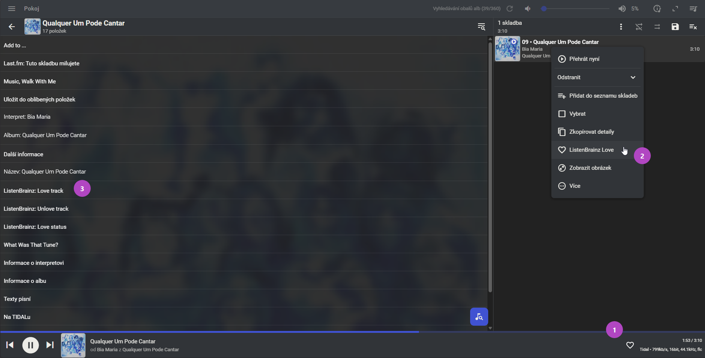

# ListenBrainzLove 0.8.0

[English](README.md)

ListenBrainzLove je plugin pro Lyrion Music Server (LMS), který přidá nebo zruší **Love** na ListenBrainz a ověří uložený stav. Vybranou skladbu můžeš označit i při zastaveném přehrávání, pokud ji LMS dokáže identifikovat. Dokončené poslechy dál odesílá stávající scrobbler.

Plugin vyžaduje LMS 9.1.0 nebo novější. Nabídka skladby a volitelné srdíčko v Material Skin vyžadují verzi 6.4.6 nebo novější.

## Instalace

1. V LMS otevři **Settings → Plugins → Additional repositories** a přidej adresu repozitáře.

   ```text
   https://raw.githubusercontent.com/vysmaty/lyrion-listenbrainz-love/main/repo.xml
   ```

2. Použij změny, vyber **ListenBrainz Love** a podle výzvy plugin nainstaluj a restartuj LMS.
3. V nastavení pluginu zadej uživatelské jméno a token ListenBrainz. Plugin ověří, že token patří k účtu. Prázdné pole při uložení zachová stávající token.

Pro ruční instalaci stáhni instalační ZIP z [GitHub Releases](https://github.com/vysmaty/lyrion-listenbrainz-love/releases). V kořeni ZIPu je `install.xml`. LMS stahuje stejný ZIP z tagu `dist-vX.Y.Z` a kontroluje jeho SHA-1.

## Použití



1. **Srdíčko v desktopovém přehrávači.** Zapni ho v nastavení pluginu a obnov Material Skin. Kliknutím přidáš nebo zrušíš Love, pravým kliknutím načteš uložený stav. Před odinstalací volbu vypni, aby LMS odstranil blok pluginu z `prefs/material-skin/custom.js`.
2. **Nabídka skladby.** V Material Skin zvol **ListenBrainz Love** u skladby v knihovně nebo ve frontě. Ověřený výsledek se zobrazí v oznámení a zůstaneš v aktuálním pohledu.
3. **Detail skladby.** Použij **ListenBrainz: Love track**, **ListenBrainz: Unlove track** nebo **ListenBrainz: Love status**. Stejné akce jsou dostupné i ve standardních informacích o skladbě v LMS.

Plné srdíčko znamená potvrzené Love, obrys znamená skladbu bez Love a otazník neznámý stav. Pokud se zápis nepodařilo ověřit, před dalším pokusem obnov stav.

## Jak plugin pozná nahrávku

Plugin dává přednost důvěryhodnému ID nahrávky z MusicBrainz (MBID). Při dohledávání používá odpovídající poslechy z ListenBrainz a vyhledávání podle metadat. Rozlišuje stav uložený pod ListenBrainz MSID a stav s potvrzenou vazbou na MusicBrainz.

Pokud se shoda nenajde a vybraná skladba právě hraje, může ruční akce Love odeslat jedno dočasné oznámení `playing_now`, aby získala MSID. Skladbu bez spolehlivé identity lze označit, až budou dostupná potřebná metadata a podaří se ji dohledat. [Podrobnosti o identitě a API](https://github.com/vysmaty/lyrion-listenbrainz-love/blob/main/docs/UPSTREAM.md)

## Řešení potíží

- U vzdálené skladby s chybějícími metadaty počkej na poskytovatele a obnov stav Love. Plugin na metadata při jednom pokusu čeká nejvýše osm sekund.
- Změny provedené na ListenBrainz načteš hned přes **ListenBrainz: Love status** nebo pravým kliknutím na srdíčko. Automatická kontrola může až 30 sekund používat poslední ověřený stav.
- Příkaz `listenbrainzlove metadata` zobrazí metadata LMS a poskytovatele bez požadavku na ListenBrainz. LMS ukládá token v nešifrovaných místních nastaveních, proto omez přístup k serveru a jeho souborům.

## Vývoj

Offline testy spustíš příkazem `prove -v t` s Perlem a Node.js. Příkaz `python tools/build.py` spustí testy a do `dist/` uloží instalační ZIP, zdrojový archiv, kontrolní součty a vygenerovaný manifest.

Před vydáním aktualizuj verzi v `install.xml`, User-Agentu, loaderu Materialu a obou README. Posuň pevný čas ZIPu v `tools/build.py`, aby LMS obnovil cache. Odešli odpovídající tag `vX.Y.Z` na commitu z větve `main`. Před aktualizací `repo.xml` se ověří příloha GitHub Release i raw odkaz. [Akce Release](https://github.com/vysmaty/lyrion-listenbrainz-love/blob/main/.github/workflows/release.yml)

## Autorství

Plugin spravuje [vysmaty](https://github.com/vysmaty). Na jeho přípravě a vývoji spolupracovala AI.

[Licence MIT](LICENSE)
