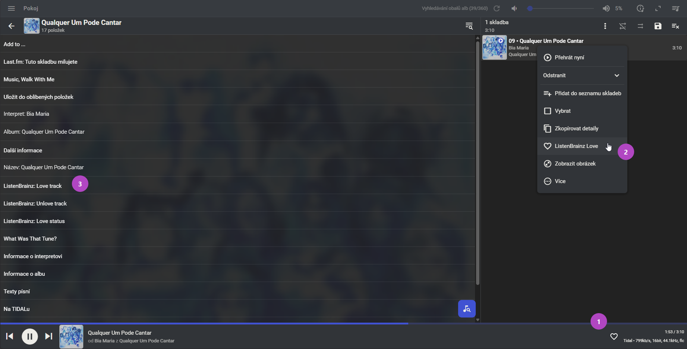

# ListenBrainzLove 0.8.0

[Česky](README.cs.md)

ListenBrainzLove is a plugin for Lyrion Music Server (LMS) that adds or removes **Love** on ListenBrainz and verifies the saved state. You can use it on a selected track even when playback is stopped, provided LMS can identify the recording. Your existing scrobbler continues to handle completed listens.

Requires LMS 9.1.0 or later. The Material Skin context menu and optional desktop heart require Material Skin 6.4.6 or later.

## Install

1. In LMS, open **Settings → Plugins → Additional repositories** and add the repository URL.

   ```text
   https://raw.githubusercontent.com/vysmaty/lyrion-listenbrainz-love/main/repo.xml
   ```

2. Apply the change, select **ListenBrainz Love**, and follow the prompts to install and restart.
3. In the plugin settings, enter your ListenBrainz username and token. The plugin verifies that the token belongs to the account. Leave the token field blank when saving to keep the current token.

For manual installation, download the named installer ZIP from [GitHub Releases](https://github.com/vysmaty/lyrion-listenbrainz-love/releases). It contains `install.xml` at its root. LMS downloads the same ZIP from a `dist-vX.Y.Z` tag and checks its SHA-1.

## Use



1. **Desktop heart.** Enable it in the plugin settings and reload Material Skin. Click to add or remove Love. Right-click to refresh the saved state. Disable this option before uninstalling so LMS can remove the plugin’s block from `prefs/material-skin/custom.js`.
2. **Track menu.** In Material Skin, choose **ListenBrainz Love** for a track in the library or queue. A popup shows the verified result and keeps you in the current view.
3. **Track details.** Open **ListenBrainz: Love track**, **ListenBrainz: Unlove track**, or **ListenBrainz: Love status**. These actions are also available in standard LMS track information.

A filled heart means Love is confirmed, an outline means Love is off, and a question mark means the state is unknown. If a save could not be verified, refresh the status before trying the action again.

## How it identifies a recording

The plugin prefers a trusted MusicBrainz recording ID (MBID). When it needs to resolve a recording, it uses matching ListenBrainz listens and a metadata lookup. It distinguishes feedback stored against a ListenBrainz recording MSID from confirmed MusicBrainz linkage.

If there is no match and the selected track is actively playing, an explicit Love action may send one temporary `playing_now` notification to obtain an MSID. A track with no reliable identity can be marked only after its metadata is available and the identity can be resolved. [Identity and API details](https://github.com/vysmaty/lyrion-listenbrainz-love/blob/main/docs/UPSTREAM.md)

## Troubleshooting

- For a remote track whose metadata is still loading, wait for the provider and refresh the Love status. The plugin waits up to eight seconds for metadata on each attempt.
- For changes made on ListenBrainz, use **ListenBrainz: Love status** or right-click the desktop heart to refresh immediately. Automatic checks may reuse a verified result for up to 30 seconds.
- `listenbrainzlove metadata` shows LMS and provider metadata without making a ListenBrainz request. LMS stores the token in unencrypted local preferences, so restrict access to the server and its files.

## Development

Run `prove -v t` with Perl and Node.js for the offline test suite. `python tools/build.py` runs the tests and writes the installer, source archive, checksums, and generated manifest to `dist/`.

To release, update the version in `install.xml`, the User-Agent, the Material loader, and both READMEs. Advance the fixed ZIP timestamp in `tools/build.py` so LMS refreshes its caches. Push the matching `vX.Y.Z` tag on a commit from `main`. The workflow verifies the GitHub Release attachment and raw download before updating `repo.xml`. [Release workflow](https://github.com/vysmaty/lyrion-listenbrainz-love/blob/main/.github/workflows/release.yml)

## Credits

Maintained by [vysmaty](https://github.com/vysmaty). AI assisted with the plugin’s development.

[MIT license](LICENSE)
